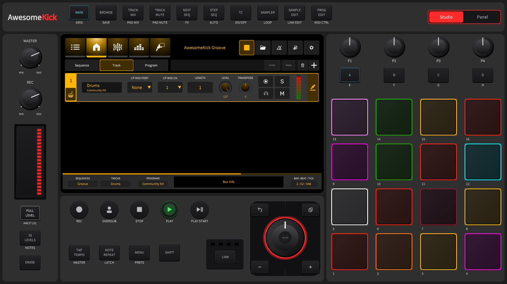

# AwesomeKick – KICK simulator for macOS, Windows and Linux

**AwesomeKick** is a community project around the open-sourced KICK groovebox firmware.
It runs the real KICK firmware as a simulator with the front panel laid out like the
hardware: as a native app on **macOS** and **Windows** (download and play, sound straight from your
computer), and on **Ubuntu / Debian** on a desktop or a **headless server**, played from any browser in your network.

<p align="center">
  
</p>

> This is a community project, not an official Behringer / MUSIC Tribe release.
> It builds on the `desktop-build` branch by [chillbeast](https://github.com/chillbeast/0700-AAM)
> and on the original source at [MusicTribeOpenSource/0700-AAM](https://github.com/MusicTribeOpenSource/0700-AAM).

## Download: macOS and Windows

Get the latest build from [Releases](https://github.com/Awesome-Kick/awesomekick/releases):

| System | File | Start |
|---|---|---|
| macOS 12+ (Apple Silicon and Intel) | `AwesomeKick-macOS.zip` | unzip, move **AwesomeKick** to *Applications*, open it |
| Windows 10/11 (x64) | `AwesomeKick-Windows.zip` | unzip to a folder you can write to (e.g. *Documents*), run `KT_KickEM.exe` |

On the first start AwesomeKick installs two playable demo projects and opens **AwesomeKick Groove** – press
**PLAY**. **Rusty Kit** (an acoustic kit) is in the file browser under *Internal*. Both use free CC0
samples, see [`Kick/demos`](Kick/demos/README.md).

The apps are not signed yet, so the system warns once:
- **macOS:** "AwesomeKick cannot be opened because the developer cannot be verified" → *System Settings →
  Privacy & Security* → **Open Anyway** (or in Terminal: `xattr -dr com.apple.quarantine /Applications/AwesomeKick.app`).
  macOS asks for the microphone: allow it if you want to sample, sound output works either way.
- **Windows:** SmartScreen "Windows protected your PC" → **More info** → **Run anyway**.

For the lowest latency choose your audio interface and a small buffer in AwesomeKick's audio settings
(macOS: 64–128 samples; Windows: *Windows Audio (Exclusive Mode)*).

## Quick start (Linux)

```bash
git clone -b linux https://github.com/Awesome-Kick/awesomekick.git
cd awesomekick
bash scripts/setup-linux.sh        # as a normal user, NOT with sudo
```

The script installs the build dependencies (asks for your sudo password once), builds the
simulator with all CPU cores and starts it. It picks the right mode by itself:

### On a Linux desktop: a normal window

If you run the script inside a desktop session (Ubuntu Desktop, KDE, …), the simulator opens as
a **normal application window**, with sound through your computer's audio device. No browser
involved. You also get an **AwesomeKick** entry in your application menu.

Start it again later from the menu, or with `~/kick-dev/kickem-desktop.sh`. You can also run the
binary directly:

```bash
cd Kick/build/sim/apps/kickem/KT_KickEM_artefacts/Release && ./KT_KickEM
```

### On a server without a screen: in the browser

On a headless machine (no desktop, e.g. a home server you reach via SSH), the simulator runs on
a virtual display and is shared to your browser. At the end the script prints the link:

```
AwesomeKick simulator is running.
  Open in a browser: http://<server-ip>:6080/
  Password:          none (use --password to set one)
  Sound:             on by default – your first click on the page turns it on
```

The simulator still runs on the server. The page shows its picture, sends your clicks and plays its
sound – on by default; browsers start audio with your first click or key press on the page (the
**Sound off** button at the top right mutes it). The sound is streamed on port 6081 – open it in your
firewall, e.g. `sudo ufw allow from 192.168.0.0/16 to any port 6081 proto tcp`. Expect about 0.1 s
delay: fine for listening, for playing the pads use the native app.

The browser view has no password, so anyone in your network can open it. Add `--password` to protect it.
Force a mode with `bash scripts/setup-linux.sh --desktop` or `--headless`.

### Afterwards

| Command | What it does |
|---|---|
| `~/kick-dev/kickem-desktop.sh` | start the simulator as a window (desktop) |
| `~/kick-dev/kickem-start.sh` | start it headless with browser access (server) |
| `~/kick-dev/kickem-stop.sh` | stop everything |
| `~/kick-dev/kickem-rebuild.sh` | rebuild after code changes and restart (in the mode chosen at setup) |

Logs are in `~/kick-dev/logs/`, your projects and preferences in `~/.local/share/KickEM/`.

Tested on Ubuntu 24.04 (x86_64).

## What this branch changes

### ⚠️ Safety sandbox – please read

The firmware assumes it runs on the KICK hardware. At startup it executes shell commands such as

```
timedatectl set-timezone Asia/Kolkata
ifconfig eth0 192.168.0.1 netmask 255.255.255.0
killall udhcpc
echo 127 > /sys/devices/platform/backlight/backlight/backlight/brightness
```

and elsewhere `mount`, `reboot`, firmware decryption and more. On a normal Linux machine – and
especially when run as root – this can change your timezone and network configuration and take
a server off the network.

In the simulator build every such call is intercepted at link time
(`-Wl,--wrap=system,popen,execve,…`, see `Kick/apps/kickem/simulator/kick_SimSandbox.cpp`).
Nothing is executed except two read-only queries (`df -h`, `du -sh`) used by the System
Resources screen. Blocked calls are logged:

```bash
grep sandbox ~/kick-dev/logs/kickem.log
```

**Never run the simulator as root.** Set `KICKEM_SANDBOX_QUIET=1` to silence the log lines.

### Linux build fixes (GCC)
- `#include <thread>` added in `AudIO/AudIO/Daw/DawRouting.cpp` and `DawEngine.cpp`.
- `juce::jmax<juce::int64>` / `jmin` replaced by `std::max` / `std::min` – with GCC the JUCE
  SIMD templates fail to compile for `long long` (see also upstream issue #9).
- `libxi-dev` is required (the bundled JUCE multitouch patch uses XInput2). `libwebkit2gtk` is
  **not** required (`JUCE_WEB_BROWSER=0`); it no longer exists in Ubuntu 24.04 anyway.

### Data paths
The firmware writes to `/app`, `/home/Kick` and `/data`. In the simulator build
(`Kick/modules/common/source/kick_paths.cpp`, `SIM_BUILD` only):
- assets, demos, templates: found next to the executable (or set `KICKEM_DATA_DIR`)
- projects, preferences, logs, samples: `~/.local/share/KickEM/`

### Front panel laid out like the hardware
Every control sits where it is on the real unit, with the same spacing: MASTER / REC pots with
MIN/MAX, LINK, touch strip, FULL LEVEL / 16 LEVELS / ERASE, 4×4 pads with numbers, P1–P4,
BANK A–D, the mode keys, the jog wheel with its LED ring and four navigation keys (undo, copy,
−, +), SHIFT, and the round transport keys. The positions were measured from a photo of the
unit; the 1024×600 screen sits where the display is.

Keys show their main function on the backlit cap and the SHIFT function printed below, as on
the panel. The look is our own – no manufacturer logo or branding; the bezel shows "AwesomeKick".

### Studio view
A second, wide layout in the style of an MPC Live: mode keys in a top bar, MASTER / REC and the touch
strip on the left, transport, jog wheel and LINK under the display, P1–P4, BANK A–D and the pads on the
right. Switch with the **Studio | Panel** chip (top right) or **F2**; `KICKEM_VIEW=studio` starts in it.
It is the basis for later tablet and phone layouts.



### Headless / browser mode
- `KICKEM_KIOSK=1` makes the window fill the whole display.
- In headless mode `setup-linux.sh` runs the simulator on a virtual display (Xvfb, 1600×1600), shares it with
  x11vnc (localhost only) and serves it via noVNC on port 6080 – without a password unless you pass `--password`.
- Sound in headless mode: the simulator plays into a JACK server without hardware; `scripts/awesomekick-audio.py`
  streams it to the browser page on port 6081.
- On a desktop the simulator simply opens as a window (`--desktop`, automatic when a desktop is running).
- On a desktop and in the native apps the sound comes straight out of your computer.

## Useful environment variables

| Variable | Effect |
|---|---|
| `KICKEM_KIOSK=1` | fill the whole display, no title bar |
| `KICKEM_VIEW=studio` | start in the studio view (default: `panel`; F2 switches) |
| `KICKEM_SHOWCASE=1` | load and play "AwesomeKick Groove"; with `KICKEM_SHOT=<dir>` save a full-size picture and quit |
| `KICKEM_DATA_DIR=<dir>` | where `assets/`, `demos/`, `templates/` are |
| `KICKEM_SANDBOX_QUIET=1` | don't log blocked system commands |
| `KICKEM_SELFTEST=1` | drive every panel control once (more: `tour`, `record`, `modular`, …) |
| `KICKEM_SELFTEST=makedemo` | create the playable demo project "AwesomeKick Groove" and quit |

## Known limitations
- The factory samples were removed from the public release, so the bundled demos and templates
  are empty (no sequence – PLAY does nothing there). For a playable demo, create **AwesomeKick Groove**
  (own synthesized drum kit, 2-bar groove) once:

  ```bash
  cd Kick/build/sim/apps/kickem/KT_KickEM_artefacts/Release && KICKEM_SELFTEST=makedemo ./KT_KickEM
  ```

  It quits by itself. Open it via the folder icon on the screen → Internal → `AwesomeKick Groove` →
  double-click `AwesomeKick Groove.kickPrj`, then press PLAY.
- LINK LEDs and the camera on the panel are decoration only.
- Only x86_64 Ubuntu has been tested so far.

## Licence
AGPL-3.0-or-later, same as upstream. Behringer and the Behringer logo are trademarks of
MUSIC Tribe and are not covered by the software licence.
