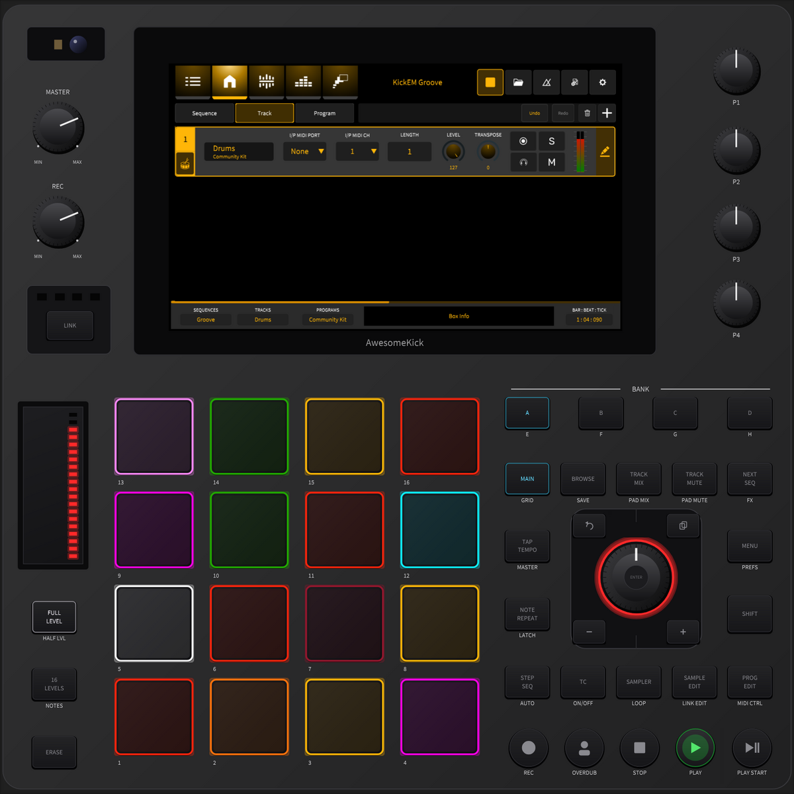

# AwesomeKick – KICK simulator on Linux

**AwesomeKick** is a community project around the open-sourced KICK groovebox firmware.
This branch builds and runs the simulator (`KT_KickEM`) on **Ubuntu / Debian** – on a desktop or on a
**headless server**, played from any browser in your network.

<p align="center">
  
</p>

> This is a community project, not an official Behringer / MUSIC Tribe release.
> It builds on the `desktop-build` branch by [chillbeast](https://github.com/chillbeast/0700-AAM)
> and on the original source at [MusicTribeOpenSource/0700-AAM](https://github.com/MusicTribeOpenSource/0700-AAM).

## Quick start

```bash
git clone -b linux https://github.com/Awesome-Kick/awesomekick.git
cd awesomekick
bash scripts/setup-linux.sh        # as a normal user, NOT with sudo
```

The script installs the build dependencies (asks for your sudo password once), builds the
simulator with all CPU cores and starts it. It picks the right mode by itself:

### On a Linux desktop: a normal window

If you run the script inside a desktop session (Ubuntu Desktop, KDE, …), the simulator opens as
a **normal application window**, with sound through your computer's audio device. No browser
involved. You also get an **AwesomeKick** entry in your application menu.

Start it again later from the menu, or with `~/kick-dev/kickem-desktop.sh`. You can also run the
binary directly:

```bash
cd Kick/build/sim/apps/kickem/KT_KickEM_artefacts/Release && ./KT_KickEM
```

### On a server without a screen: in the browser

On a headless machine (no desktop, e.g. a home server you reach via SSH), the simulator runs on
a virtual display and is shared to your browser. At the end the script prints a link and a
password:

```
AwesomeKick simulator is running.
  Open in a browser: http://<server-ip>:6080/vnc.html?autoconnect=1&resize=scale
  Password:          ********
```

The simulator still runs on the server – the browser only shows the picture and sends your
clicks, so **sound comes out of the server**, not out of the computer with the browser.

Force a mode with `bash scripts/setup-linux.sh --desktop` or `--headless`.

### Afterwards

| Command | What it does |
|---|---|
| `~/kick-dev/kickem-desktop.sh` | start the simulator as a window (desktop) |
| `~/kick-dev/kickem-start.sh` | start it headless with browser access (server) |
| `~/kick-dev/kickem-stop.sh` | stop everything |
| `~/kick-dev/kickem-rebuild.sh` | rebuild after code changes and restart (in the mode chosen at setup) |

Logs are in `~/kick-dev/logs/`, your projects and preferences in `~/.local/share/KickEM/`.

Tested on Ubuntu 24.04 (x86_64).

## What this branch changes

### ⚠️ Safety sandbox – please read

The firmware assumes it runs on the KICK hardware. At startup it executes shell commands such as

```
timedatectl set-timezone Asia/Kolkata
ifconfig eth0 192.168.0.1 netmask 255.255.255.0
killall udhcpc
echo 127 > /sys/devices/platform/backlight/backlight/backlight/brightness
```

and elsewhere `mount`, `reboot`, firmware decryption and more. On a normal Linux machine – and
especially when run as root – this can change your timezone and network configuration and take
a server off the network.

In the simulator build every such call is intercepted at link time
(`-Wl,--wrap=system,popen,execve,…`, see `Kick/apps/kickem/simulator/kick_SimSandbox.cpp`).
Nothing is executed except two read-only queries (`df -h`, `du -sh`) used by the System
Resources screen. Blocked calls are logged:

```bash
grep sandbox ~/kick-dev/logs/kickem.log
```

**Never run the simulator as root.** Set `KICKEM_SANDBOX_QUIET=1` to silence the log lines.

### Linux build fixes (GCC)
- `#include <thread>` added in `AudIO/AudIO/Daw/DawRouting.cpp` and `DawEngine.cpp`.
- `juce::jmax<juce::int64>` / `jmin` replaced by `std::max` / `std::min` – with GCC the JUCE
  SIMD templates fail to compile for `long long` (see also upstream issue #9).
- `libxi-dev` is required (the bundled JUCE multitouch patch uses XInput2). `libwebkit2gtk` is
  **not** required (`JUCE_WEB_BROWSER=0`); it no longer exists in Ubuntu 24.04 anyway.

### Data paths
The firmware writes to `/app`, `/home/Kick` and `/data`. In the simulator build
(`Kick/modules/common/source/kick_paths.cpp`, `SIM_BUILD` only):
- assets, demos, templates: found next to the executable (or set `KICKEM_DATA_DIR`)
- projects, preferences, logs, samples: `~/.local/share/KickEM/`

### Front panel laid out like the hardware
Every control sits where it is on the real unit, with the same spacing: MASTER / REC pots with
MIN/MAX, LINK, touch strip, FULL LEVEL / 16 LEVELS / ERASE, 4×4 pads with numbers, P1–P4,
BANK A–D, the mode keys, the jog wheel with its LED ring and four navigation keys (undo, copy,
−, +), SHIFT, and the round transport keys. The positions were measured from a photo of the
unit; the 1024×600 screen sits where the display is.

Keys show their main function on the backlit cap and the SHIFT function printed below, as on
the panel. The look is our own – no manufacturer logo or branding; the bezel shows "AwesomeKick".

### Headless / browser mode
- `KICKEM_KIOSK=1` makes the window fill the whole display.
- In headless mode `setup-linux.sh` runs the simulator on a virtual display (Xvfb, 1600×1600), shares it with
  x11vnc (localhost only, password protected) and serves it via noVNC on port 6080.
- On a desktop the simulator simply opens as a window (`--desktop`, automatic when a desktop is running).
- Sound always comes out of the machine the simulator runs on.

## Useful environment variables

| Variable | Effect |
|---|---|
| `KICKEM_KIOSK=1` | fill the whole display, no title bar |
| `KICKEM_DATA_DIR=<dir>` | where `assets/`, `demos/`, `templates/` are |
| `KICKEM_SANDBOX_QUIET=1` | don't log blocked system commands |
| `KICKEM_SELFTEST=1` | drive every panel control once (more: `tour`, `record`, `modular`, …) |

## Known limitations
- The factory samples were removed from the public release, so demo pads may be silent.
- LINK LEDs and the camera on the panel are decoration only.
- Only x86_64 Ubuntu has been tested so far.

## Licence
AGPL-3.0-or-later, same as upstream. Behringer and the Behringer logo are trademarks of
MUSIC Tribe and are not covered by the software licence.
