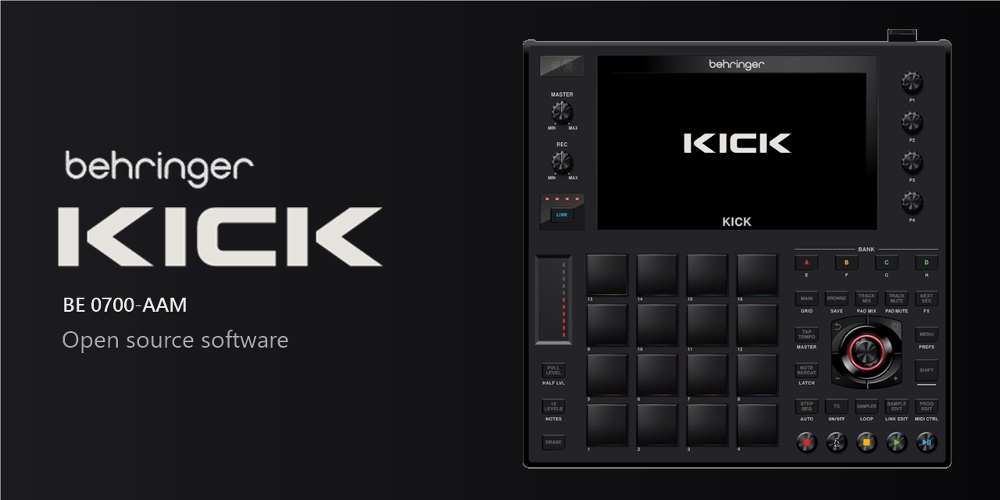
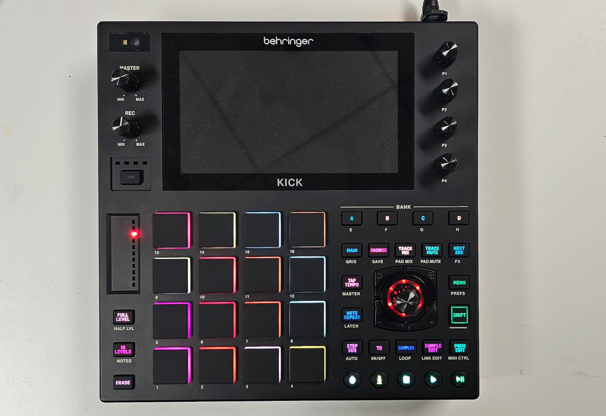
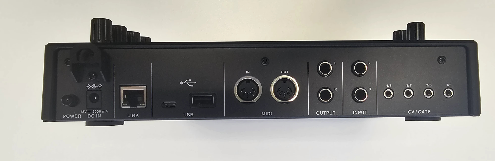
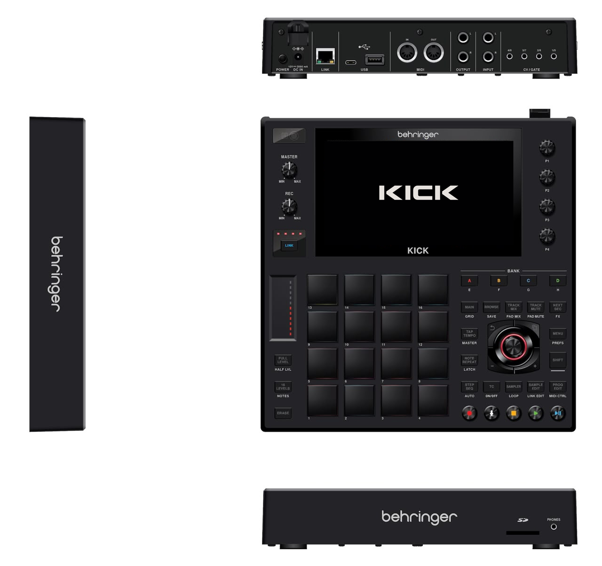

  

# Behringer KICK (BE 0700-AAM)

Source code for the Behringer KICK.

> [!NOTE]
> **About this fork: a community build, not an official Behringer / MUSIC Tribe release.**
>
> The `desktop-build` branch builds and runs the KICK firmware on Windows. It adds a hardware simulator (`KT_KickEM`), so you can play it with no KICK at all. On top of the original code it adds:
> - **Instrument programs**, with a **Modular synth engine**:
>   - a grid patch editor, cables, effects and an arpeggiator;
>   - Mono/Legato with glide, and pad pressure;
>   - 22 presets, and saving your own.
> - **Recording pads** into sequences, and REC on the Sampler.
> - **Real CPU and RAM meters**, plus many crash and UI fixes.
>
> - **Try it:** download the simulator zip from [Releases](https://github.com/chillbeast/0700-AAM/releases) (Windows x64). Unzip it anywhere and run `KT_KickEM.exe`.
> - **Manual:** [Kick/docs/manual/USER_MANUAL.md](Kick/docs/manual/USER_MANUAL.md) covers the panel, the screens and the Modular engine.
> - **Build it:** with Visual Studio 2022 and CMake, from `Kick/`:
>   `cmake -S . -B build/sim -G "Visual Studio 17 2022" -A x64 -DKICK_SIMULATOR=ON -DTIMESTAMP=OFF`, then
>   `cmake --build build/sim --config Release --target KT_KickEM`
> - **Licence:** AGPL-3.0, the same as upstream. The original code lives at [MusicTribeOpenSource/0700-AAM](https://github.com/MusicTribeOpenSource/0700-AAM).

  

## Key features

- AI camera for gesture control
- Touchscreen
- 16 RGB pads, 8 banks
- Sampler with sample editing, step sequencer and looper
- Over 300 built-in effects
- 4 assignable knobs and a jog wheel
- MIDI in/out, USB and 4 CV / Gate jacks

## Connections

  

| Rear | Front |
|---|---|
| 12 V DC power input, power switch | SD card slot |
| LINK (RJ45) | Headphones output |
| USB-C, USB-A | |
| MIDI IN, MIDI OUT (5-pin DIN) | |
| Stereo output, stereo input | |
| CV / Gate (4 jacks) | |

## Repository

| Folder | Contents | License |
|---|---|---|
| [`Kick/`](Kick) | Application | AGPL-3.0-or-later |
| [`AudIO/`](AudIO) | Audio engine library | AGPL-3.0-or-later |
| [`ComProtocol/`](ComProtocol) | Hardware communication protocol | AGPL-3.0-or-later |
| [`Linux/`](Linux) | Buildroot Linux image | GPL-2.0 (Buildroot) |

The root [`LICENSE`](LICENSE) is the AGPL-3.0 text that covers the Music Tribe code (Kick, AudIO, ComProtocol).
Third-party components keep their original licenses. See the README in each folder.

## Community

- **Chat with us:** [Discord](https://discord.gg/gS6qtuShvw)
- **Contribute:** fork the repository and open a pull request. No membership needed. See the
  [contributing guide](https://github.com/MusicTribeOpenSource/.github/blob/main/CONTRIBUTING.md).
- **Report a security problem** privately: [Report a vulnerability](https://github.com/MusicTribeOpenSource/0700-AAM/security/advisories/new).

Product renders

  

---

Behringer is a brand of MUSIC Tribe. The Behringer name and logo, and the KICK name and logo, are
trademarks and are not covered by the software licenses in this repository.

Copyright (c) MUSIC Tribe.
